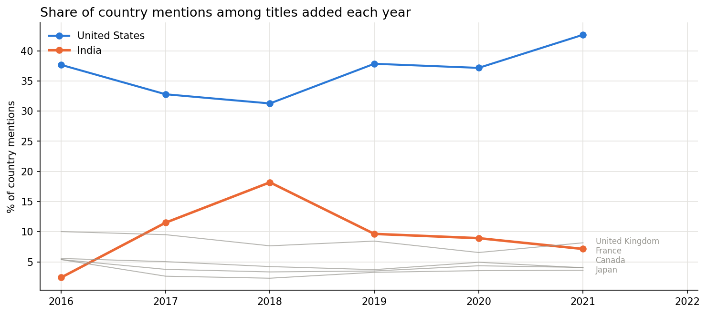
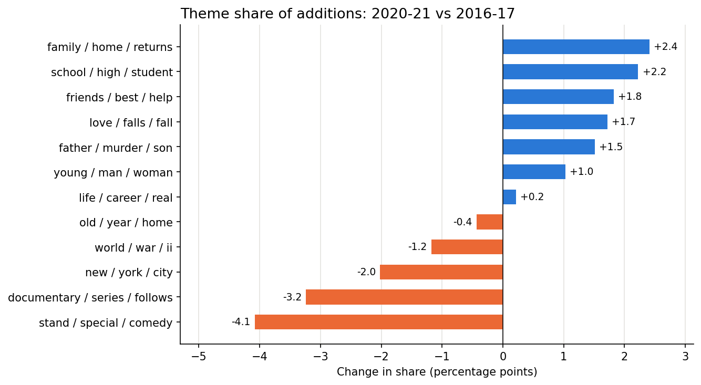

# Netflix content strategy, 2015–2021

**Question:** what has Netflix been prioritising in what it adds to its catalogue, what should a competing streamer take from it, and can the catalogue alone power a "because you watched" feature?

**[Live dashboard →](https://netflix-catalogue-trends.vercel.app/)** (trends and a searchable recommender)

**Tools:** Python (pandas, statsmodels, scikit-learn), pytest · **Notebook:** [`netflix_content_strategy.ipynb`](netflix_content_strategy.ipynb) · **Package:** [`src/netflix_analytics`](src/netflix_analytics) · **Methodology:** [`docs/methodology.md`](docs/methodology.md)

## Findings

Among titles still on Netflix in 2021 (see *Limitations*). Every change below is tested; p-values are in the notebook.

| | Finding |
|---|---|
| **Growth levelled off** | Additions peaked in 2019 at 2,016 titles; 2021 (Jan–Sep) annualises to about 2,000. |
| **Back towards TV** | TV's share of additions fell to 25% in 2018, then rose every year to 34% in 2021: odds up 15% a year (p = 2.5×10⁻⁸). |
| **India: a short, sharp bet** | India's share of country mentions went from 2.4% (2016) to 18.2% (2018), then down to 7.1% (2021); both moves p < 10⁻¹⁸. The US rose from 31% to 43%. |
| **Genre and theme shift** | Comedies (+3.4 pts) and dramas (+3.3) gained the most share between 2016–17 and 2020–21; documentaries (−5.0) and stand-up (−2.7) lost the most. Topic modelling of the descriptions independently finds the same: the stand-up and documentary themes fell most. |
| **More back-catalogue movies** | The share of movies added within a year of release fell from 75% (2016) to 40% (2021) (p = 10⁻³¹). |
| **Kids content returning** | Kids and family titles rose from 10.1% of additions (2018) to 16.7% (2021) (p = 6.6×10⁻¹¹). |
| **A catalogue-only recommender works** | Description-based recommendations share a genre with the title asked about 63.4% of the time, vs 41.7% for random titles of the same type: **+21.8 points** (95% CI 20.5–23.0). |





## Recommendations for a competing streamer

1. **Compete on retention, not catalogue size.** With additions flat and TV rising, Netflix is optimising for series that keep subscribers watching; benchmark against TV hours, not title count.
2. **Treat regional expansion as a multi-year commitment.** Netflix's India share jumped sevenfold and then fell by 60% within three years; a launch spike is not a strategy.
3. **Move on family content early.** Netflix is rebuilding its kids catalogue.
4. **Ship a content-based recommender from day one.** It needs no viewing history, so it works for new users and new titles, and it can be blended with collaborative filtering once viewing data exists.

## Concepts and techniques

**Data preparation and quality**
- Parsing with explicit formats so bad values surface instead of being guessed (10 unparseable dates found)
- Fixing a data-entry shift (durations stored in the rating column)
- Domain-aware validation: for TV shows `release_year` is the latest season, so "content age" is computed for movies only
- Multi-valued fields exploded so every co-producing country and genre is counted (`explode_list`)
- Derived indicators: TV, kids, mature and "fresh release" flags

**Statistics and inference**
- Wilson score confidence intervals for yearly shares
- Logistic-regression trend tests (odds ratio per year, CI, p-value)
- Chi-square tests for differences between years
- Effect sizes alongside p-values (percentage points, odds ratios)
- Bootstrap confidence intervals for an evaluation metric
- Selection and survivorship bias: the 2021 snapshot is missing titles that were removed

**Natural language processing and machine learning**
- TF-IDF text representation (stop words, document-frequency limits, sublinear term frequency)
- Topic modelling with non-negative matrix factorisation (NMF)
- Choosing the number of topics by stability across random restarts (Hungarian matching of topics)

**Recommender systems**
- Content-based recommendation with cosine similarity
- Hybrid feature blending: description, genres, director and cast, each L2-normalised and weighted
- Offline evaluation with a proxy target, leakage control (genres excluded from the evaluated model's input) and a type-matched random baseline, which shows how a naive baseline overstates the lift

**Business analytics**
- Competitive content-strategy analysis, a growth and mix trend read-out, and recommendations for a competing streamer
- Executive summary ([SUMMARY.md](SUMMARY.md)) and an interactive dashboard

**Engineering**
- Tested Python package (`src/netflix_analytics`, pytest), notebook re-executed in CI, pinned dependencies, static dashboard built from the same code

## Data quality

`load_titles` fixes and reports, never silently drops:
- **10 titles** with unparseable `date_added`: excluded from time trends.
- **3 Louis C.K. specials** with the duration stored in `rating`: moved back to `duration`.
- **12 TV shows "added before release":** for TV shows `release_year` is the year of the *latest season* (Sense8: added 2016, final season 2018). "Years between release and arrival" is therefore computed for **movies only**. An earlier version of this analysis mixed movies and shows here.
- **Every co-producing country counted**, not just the first listed.
- **2021 is partial** (to 25 September): annualised for the growth comparison only, never for shares.

## How it's built

```
01-netflix-content-strategy/
├── netflix_content_strategy.ipynb   # narrative; every number above is printed here
├── src/netflix_analytics/
│   ├── data.py        # load, clean, validate; quality report
│   ├── trends.py      # shares with Wilson CIs, trend and difference tests, share changes
│   ├── topics.py      # TF-IDF + NMF themes, stability across restarts
│   └── recommend.py   # content recommender and offline genre-agreement evaluation
├── tests/             # 11 tests: real-file quality report, trend detection, topic separation, recommender behaviour
└── docs/methodology.md
```

## Limitations

- **Snapshot, not history.** Titles added and later removed are missing, so earlier years are under-counted and look "fresher" than they were.
- **Counts of titles, not viewing hours:** this shows what Netflix *added*, not what audiences *watched*.
- **Recommender evaluated by proxy:** genre agreement shows relevance, not whether people would click.

## Run it

From the repository root:

```bash
make setup
.venv/bin/python -m pytest 01-netflix-content-strategy/tests
.venv/bin/python tools/run_notebooks.py 01-netflix --write
```

```python
from netflix_analytics import data, recommend
df, report = data.load_titles("01-netflix-content-strategy/netflix_titles.csv")
recommend.ContentRecommender().fit(df).recommend("Stranger Things", k=5)
```

## Data

[Netflix Movies and TV Shows](https://www.kaggle.com/datasets/shivamb/netflix-shows) by Shivam Bansal (Kaggle), 8,807 titles, included as `netflix_titles.csv`.
