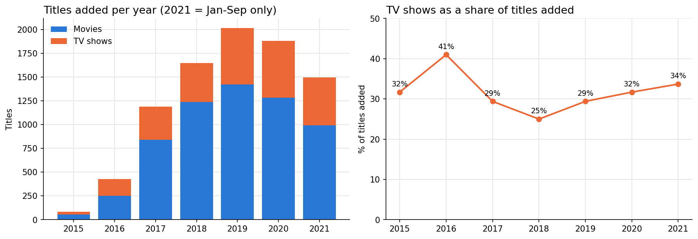
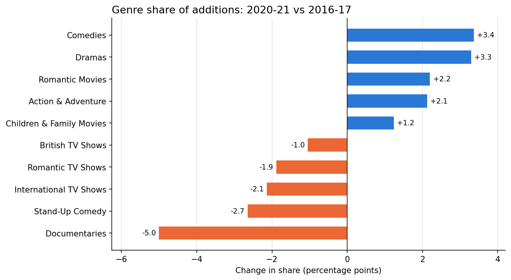

# Netflix content strategy, 2015–2021

**Question:** what has Netflix been prioritising in what it adds to its catalogue, and what should a competing streamer take from it?

**Tools:** Python (pandas, matplotlib), Jupyter · **Notebook:** [`netflix_content_strategy.ipynb`](netflix_content_strategy.ipynb)

## Findings

Among titles still on Netflix in 2021 (see *Limitations*):

| | Finding |
|---|---|
| **Growth levelled off** | Additions peaked in 2019 at 2,016 titles; 2021 (Jan–Sep) annualises to about 2,000. |
| **Back towards TV** | TV's share of additions fell to 25% in 2018, then rose every year to 34% in 2021. |
| **India: a short, sharp bet** | India went from 2.4% of country mentions in 2016 to 18.2% in 2018, then fell back to 7.1% in 2021, while the US rose from 31% to 43%. |
| **Genre shift** | Comedies (+3.4 pts) and dramas (+3.3) gained the most share between 2016–17 and 2020–21; documentaries (−5.0) and stand-up (−2.7) lost the most. |
| **More back catalogue** | The share of titles added within a year of release fell from 82% (2015) to 51% (2021). |
| **Kids content returning** | Kids and family titles rose from 10.1% of additions (2018) to 16.7% (2021). |





## Recommendations for a competing streamer

1. **Compete on retention, not catalogue size.** With additions flat and TV rising, Netflix is optimising for series that keep subscribers watching; benchmark against TV hours, not title count.
2. **Treat regional expansion as a multi-year commitment.** Netflix's India share jumped sevenfold and then halved; a launch spike is not a strategy.
3. **Move on family content early.** Netflix is rebuilding its kids catalogue; a family-focused service has a closing window.

## Method notes

- **Every listed country is counted**, not just the first one, so co-productions (e.g. "United States, India") aren't undercounted.
- **Data quality fixes:** 10 titles have unparseable `date_added` values and are excluded from time trends; 3 Louis C.K. specials had their duration stored in the `rating` column and were moved back.
- **2021 is partial** (to 25 September): it is annualised for the growth comparison only, never for shares.
- Genre changes compare two-year windows (2016–17 vs 2020–21) to smooth out single-year noise.

## Limitations

- **Snapshot, not history.** The dataset lists titles available in 2021. Titles added and later removed, often licensed content, are missing, so earlier years are under-counted and look "fresher" than they were.
- Counts of titles, not viewing hours: this shows what Netflix *added*, not what audiences *watched*.

## Data

[Netflix Movies and TV Shows](https://www.kaggle.com/datasets/shivamb/netflix-shows) by Shivam Bansal (Kaggle), 8,807 titles, included as `netflix_titles.csv`.

## Run it

```bash
pip install pandas numpy matplotlib jupyter
jupyter notebook netflix_content_strategy.ipynb
```
