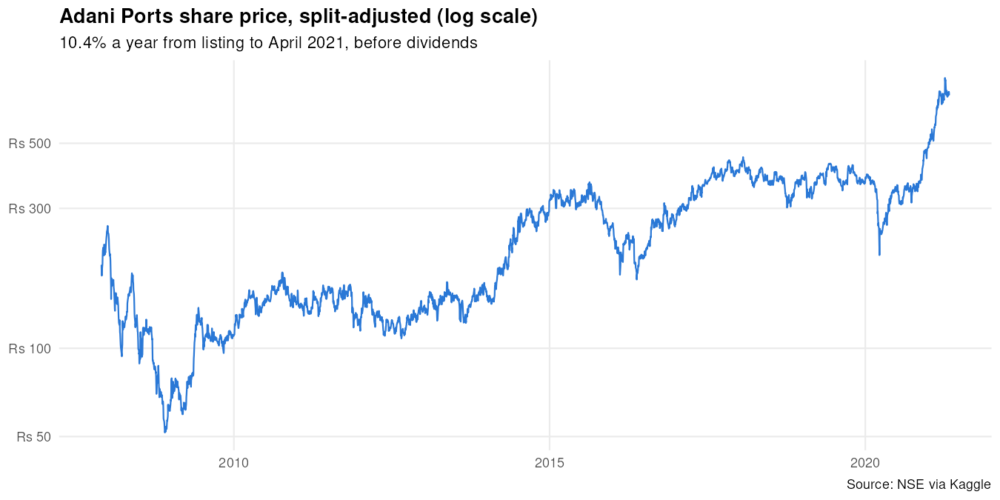
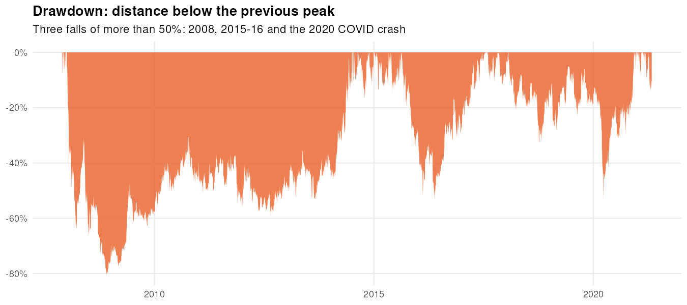
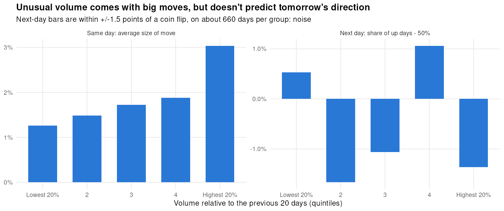

# Adani Ports stock, 2007–2021: risk and return for an investor

**Question:** what did it actually take to hold Adani Ports (NSE: ADANIPORTS) from its 2007 listing to 2021, and does unusual trading volume tell you where the price goes next?

**Tools:** R (tidyverse, lubridate, ggplot2) · **Script:** [`adani_ports_analysis.R`](adani_ports_analysis.R)

> This is one company's stock, not the NIFTY 50 index. It comes from a Kaggle dataset of NIFTY 50 constituents, which is where earlier versions of this project got the "NIFTY 50" name.

## Findings

| | Finding |
|---|---|
| **Long-run return** | **10.4% a year** in price from listing (27 Nov 2007) to 30 Apr 2021, before dividends. |
| **Risk** | Annualised volatility of **42.7%**; the price swung from −75% (2008) to +104% (2014) in a calendar year. |
| **The 2008 crash** | An **80% fall** from the January 2008 peak to November 2008, and **6.5 years to recover** (July 2014). |
| **Other big falls** | −53% (Aug 2015 → May 2016, recovered June 2017) and −54% at the COVID low (23 Mar 2020, recovered Dec 2020). |
| **Volume doesn't predict direction** | Unusual volume comes with bigger moves on the same day (correlation 0.34), but not with the next day's direction: after the top 5% volume days the stock rose next day 49.4% of the time, vs 49.5% on all days. |





## What it means for an investor

- A 10% annual return came with **three falls of more than 50%**. Holding through 2008 meant waiting six and a half years just to get back to even, so position size matters more than the entry point.
- **Volume spikes are a volatility signal, not a direction signal.** They are useful for risk (expect a big move) but not as a buy or sell trigger.

## Method notes

- **Share split corrected.** On 23 Sep 2010 the price "fell" from ₹837 to ₹165.6: a 5-for-1 split (face value ₹10 → ₹2), not a crash. Earlier prices are divided by 5 and volumes multiplied by 5. Without this, the chart shows a fake 80% collapse.
- **No rows dropped.** The `Trades` column was only reported from June 2011. Dropping rows with any missing value would silently delete 866 days (26% of the data), including the whole 2008 crash.
- **Ticker change handled.** The stock traded as MUNDRAPORT until 16 Jan 2012 and ADANIPORTS after.
- Abnormal volume is the log of the day's volume minus its average over the previous 20 trading days, so it only uses information available that day.
- Returns are price-only; dividends would add a little to the 10.4%.

## Data

`ADANIPORTS.csv`: daily NSE prices, 3,322 trading days, from [NIFTY-50 Stock Market Data](https://www.kaggle.com/datasets/rohanrao/nifty50-stock-market-data) by Rohan Rao (Kaggle).

## Run it

```bash
Rscript adani_ports_analysis.R      # needs tidyverse, lubridate, scales
```

Or without installing R, using Docker:

```bash
docker run --rm -v "$PWD":/work -w /work rocker/tidyverse:4.4.2 Rscript adani_ports_analysis.R
```
