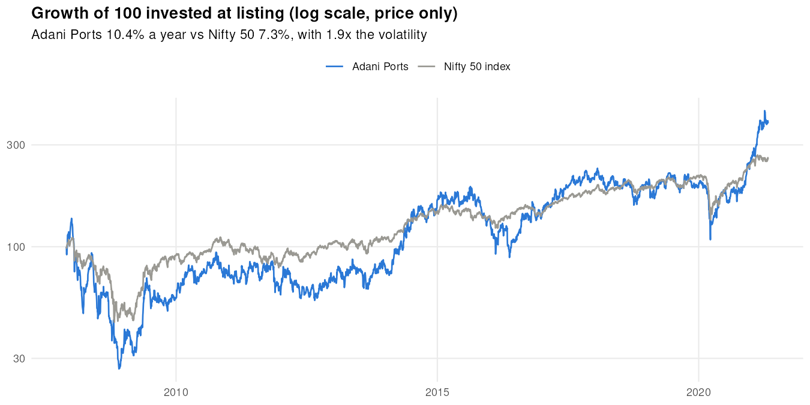
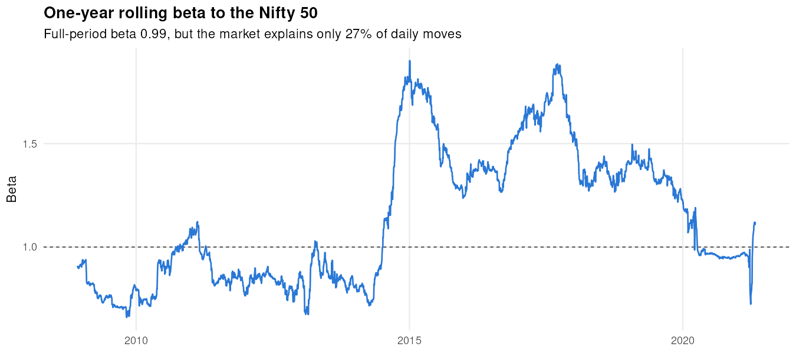
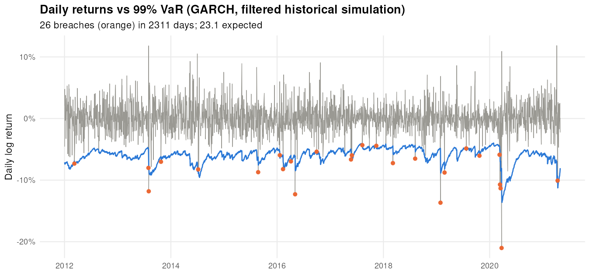

# Adani Ports stock, 2007–2021: return, risk and market exposure

**Question:** what did holding Adani Ports (NSE: ADANIPORTS) from its 2007 listing to 2021 actually involve: how did it compare with the market, how should its daily risk be measured, and does unusual trading volume say where the price goes next?

**Tools:** R (tidyverse, ggplot2, testthat); GARCH and VaR backtests implemented from scratch · **Script:** [`adani_ports_analysis.R`](adani_ports_analysis.R) · **Results:** [`results/summary.md`](results/summary.md) · **Methodology:** [`docs/methodology.md`](docs/methodology.md)

> One company's stock, not the NIFTY 50 index. The data comes from a Kaggle dataset of NIFTY 50 constituents, which is where earlier versions of this project got the "NIFTY 50" name. The actual index is now used as the benchmark.

## Findings

All numbers are generated into [`results/summary.md`](results/summary.md) by the script.

**Return and risk vs the Nifty 50** (price only, 27 Nov 2007 – 30 Apr 2021)

| | Annual return | Volatility | Return / risk | Max drawdown |
|---|---|---|---|---|
| Adani Ports | **10.4%** | 42.7% | 0.24 | **−80%** |
| Nifty 50 index | 7.3% | 22.4% | **0.32** | −60% |

The stock beat the index on return, but with 1.9× the volatility it **lost on risk-adjusted return**. The 2008 crash took **6.5 years** to recover from.

**Market exposure.** Beta **0.99** (95% CI 0.93–1.04), yet the market explains only **27%** of daily moves; **73% is company-specific**. Beta shifted with the business: about 0.88 in 2007–12, **1.30 in 2013–17**, 1.06 in 2018–21.

**Volatility clusters.** A GARCH(1,1) model gives persistence 0.976: a volatility shock halves in about **28 trading days**, so calm and turbulent periods each last weeks to months.

**Measuring daily risk: 99% one-day Value-at-Risk**, backtested on 2,311 days (2012–2021), 23.1 breaches expected:

| Method | Breaches | Kupiec p | Average VaR | Verdict |
|---|---|---|---|---|
| Historical (500 days) | 24 | 0.85 | 6.48% | Passes |
| GARCH, normal tails | **36** | **0.013** | 5.61% | **Fails**: normal tails understate crashes |
| GARCH, filtered historical simulation | 26 | 0.55 | **5.99%** | **Passes with less capital than historical** |

**Volume doesn't predict the next day.** Unusual volume comes with bigger moves on the same day (correlation 0.34), but in Granger tests at 1, 3, 5 and 10 lags, only 1 of 8 is below p = 0.05, none survives a multiple-testing correction, and volume never adds more than 0.52% of explained variance.





## What it means for an investor or risk team

- **Size the position for the drawdown, not the average return.** A 10% annual return came with three falls of more than 50%.
- **Most of the risk is the company, not the market,** so index hedges remove only about a quarter of daily variance.
- **For risk limits, use GARCH with filtered historical simulation.** It tracks volatility as it changes, keeps the right breach rate, and needs a smaller average buffer than a static historical window. Avoid normal-distribution VaR for a stock like this.
- **Treat volume spikes as a volatility warning, not a trading signal.**

## How it's built

```
02-adani-ports-stock-analysis/
├── adani_ports_analysis.R    # orchestration: charts -> figures/, every number -> results/
├── R/
│   ├── data.R                # load, detect and adjust splits, validate (stops on bad data)
│   ├── performance.R         # CAGR, volatility, return/risk ratios, drawdowns and recovery
│   ├── market.R              # beta, alpha, R-squared, rolling beta
│   ├── garch.R               # GARCH(1,1) maximum likelihood, forecasting, simulation
│   ├── var.R                 # rolling VaR (3 methods), Kupiec and Christoffersen tests
│   └── volume.R              # abnormal volume, Granger causality F-test
├── tests/testthat/           # 32 expectations: split handling, GARCH parameter recovery, no look-ahead in VaR...
├── results/                  # summary.md and CSVs, regenerated on every run
├── data/                     # ADANIPORTS.csv, NIFTY50_INDEX.csv
└── docs/methodology.md
```

## Data quality

- **Share split corrected.** On 23 Sep 2010 the price "fell" from ₹837 to ₹170.6 at the open: a 5-for-1 split, now detected automatically (Prev Close / Open close to a whole number) rather than hard-coded. Without it the chart shows a fake 80% collapse.
- **Strict parsing.** The index file marks one unknown dividend yield with "-"; it is read as missing explicitly, and the loader stops on any other value that fails to parse instead of silently turning it into NA.
- **No rows dropped.** Removing rows with any missing value would delete 866 days (26% of the data), including the whole 2008 crash.
- **Ticker change handled:** MUNDRAPORT until 16 Jan 2012, ADANIPORTS after.

## Run it

```bash
make r-test     # unit tests in Docker (rocker/tidyverse:4.4.2)
make r-run      # full analysis: figures/ and results/
```

Or with a local R 4.x and the tidyverse: `Rscript tests/run_tests.R` and `Rscript adani_ports_analysis.R` from this folder.

## Data

- `data/ADANIPORTS.csv`: daily NSE prices, 3,322 trading days, from [NIFTY-50 Stock Market Data](https://www.kaggle.com/datasets/rohanrao/nifty50-stock-market-data) by Rohan Rao (Kaggle).
- `data/NIFTY50_INDEX.csv`: Nifty 50 index levels, 2007–2021 subset of [Nifty Indices Dataset](https://www.kaggle.com/datasets/sudalairajkumar/nifty-indices-dataset) by Sudalai Rajkumar (Kaggle, version 7).
