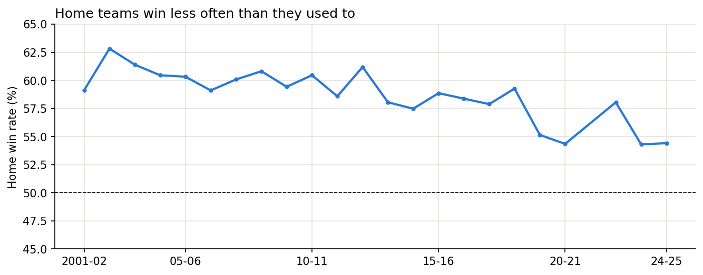
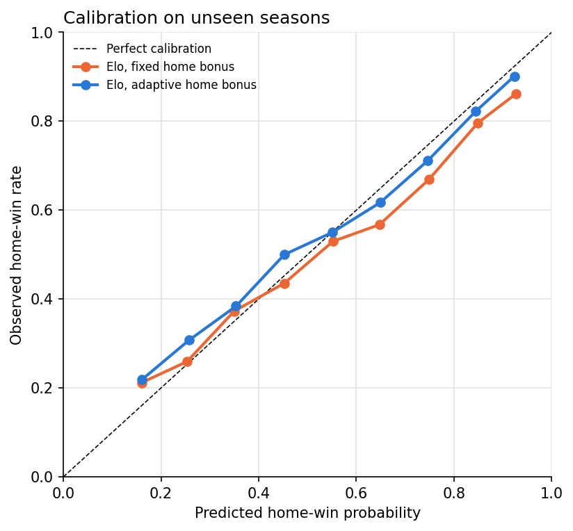

# What separates winning performances in the NBA, and can we predict them?

**Part 1, explain:** of the four things a team controls (shooting efficiency, turnovers, offensive rebounding and free throws), which matters most for winning, and has the 3-point era changed it?
**Part 2, predict:** before tip-off, how well can a game be called, and do recent-form statistics add anything beyond a team-strength rating?

**Tools:** Python (pandas, scikit-learn, statsmodels-style evaluation), pytest · **Notebook:** [`nba_four_factors.ipynb`](nba_four_factors.ipynb) · **Package:** [`src/nba_analytics`](src/nba_analytics) · **Methodology:** [`docs/methodology.md`](docs/methodology.md)

## Findings

Across **27,597 regular-season games, 2001-02 to 2024-25** (data-quality exclusions below):

**Explaining results**

| | Finding |
|---|---|
| **Shooting decides most games** | The team with the better effective field-goal % (eFG%) won **81.0%** of games. Being better on turnovers, offensive rebounds or free throws alone wins only 56–60%. |
| **Relative weights** | Shooting **47%**, turnovers 22%, offensive rebounding 17%, free throws 14%, close to Dean Oliver's 40/25/20/15. |
| **The 3-point era barely moved them** | 3-pointers rose from 18% to 42% of all shots; shooting's weight rose from 46% to 48%, free throws' fell from 15% to 12%. |

**Predicting results** (test seasons 2020-21 and 2022-23 to 2024-25, never used for fitting or model choice)

| | Finding |
|---|---|
| **About 64% of games can be called before tip-off** | Elo 64.0% and logistic regression 64.5% accuracy, against 55.5% for "the home team always wins". |
| **Home advantage has shrunk** | Home teams won 60.4% of games in 2001-02 to 2010-11 and 55.3% from 2019-20 on. A fixed home bonus makes ratings overconfident: it predicted 59.5% home wins on the test seasons against 55.5% actual. An adaptive bonus (from past seasons only) predicted 55.1%. |
| **Recent form adds no reliable signal beyond calibrated Elo** | Log-loss gap of logistic regression vs Elo: −0.0010, 95% CI [−0.0046, +0.0025]. Gradient boosting was slightly worse than Elo. |





## Recommendations

- **Coaching:** spend the most time on shot quality, both taking good shots and forcing bad ones; the model weighs your eFG% and your opponent's equally. Ball security is the second lever, worth about half as much.
- **Forecasting:** use the simple model, Elo with an adaptive home bonus. It matches the more complex models, is interpretable and is cheap to run. To beat it, add information Elo doesn't contain (injuries, lineups, travel) rather than reprocessing box scores.

## How it's built

```
03-nba-winning-performances/
├── download_data.py          # fetches the pinned Kaggle version into data/
├── nba_four_factors.ipynb    # the narrative: every number in this README is printed here
├── src/nba_analytics/
│   ├── data.py               # loading, season completeness, inconsistent-game removal, strict validation
│   ├── four_factors.py       # Four Factors formulas, opponent join, factor win rates
│   ├── elo.py                # Elo ratings, adaptive home bonus, parameter tuning
│   ├── features.py           # leakage-free pre-game features (rolling form, rest)
│   └── models.py             # explanatory weights, time split, model comparison, calibration, bootstrap
├── tests/                    # 18 tests, incl. a leakage test and a real-data quality check
└── docs/methodology.md       # protocol, metrics, design decisions, limitations
```

**Key engineering choices**
- **No leakage by construction:** pre-game features are rolling means shifted by one game, and Elo probabilities are recorded before each result updates the ratings. Both are unit-tested by changing a game and checking that only *later* features move.
- **Time-based validation:** train 2001-02 to 2016-17, validate 2017-18 to 2019-20, test the rest once. Elo parameters are tuned on train only; the fixed-vs-adaptive choice is made on validation.
- **Probabilistic scoring:** log loss and Brier score alongside accuracy, with bootstrap confidence intervals for model comparisons.

## Data quality

`prepare_games` reports everything it removes:
- **2021-22 season:** the source has 1 game, so the season is excluded. 2000-01, which has 592 of 1,189 games, is outside the window.
- **4 games with untrustworthy results:** two tied final scores (impossible in the NBA, so overtime points are missing) and two 2025 games recorded as 0–0.

Shortened seasons that really happened (2011-12 lockout, 2019-20 and 2020-21 COVID) are kept.

## Run it

From the repository root:

```bash
make setup                                   # .venv with pinned dependencies + this package
.venv/bin/python 03-nba-winning-performances/download_data.py
make test                                    # unit + data-validation tests
.venv/bin/python tools/run_notebooks.py 03-nba --write
```

Use the package directly:

```python
from nba_analytics import data, elo
games, report = data.prepare_games("03-nba-winning-performances/data/TeamStatistics.csv", 2001, 2024)
ratings = elo.run_elo(data.home_view(games), elo.EloParams(k=15, home_advantage=80, adaptive_home=True))
```

## Data

[Historical NBA Data and Player Box Scores](https://www.kaggle.com/datasets/eoinamoore/historical-nba-data-and-player-box-scores) by Eoin A Moore (Kaggle), `TeamStatistics.csv`, **pinned to version 552** because the dataset is updated daily. Not stored in the repo (36 MB); no Kaggle account needed to download.
