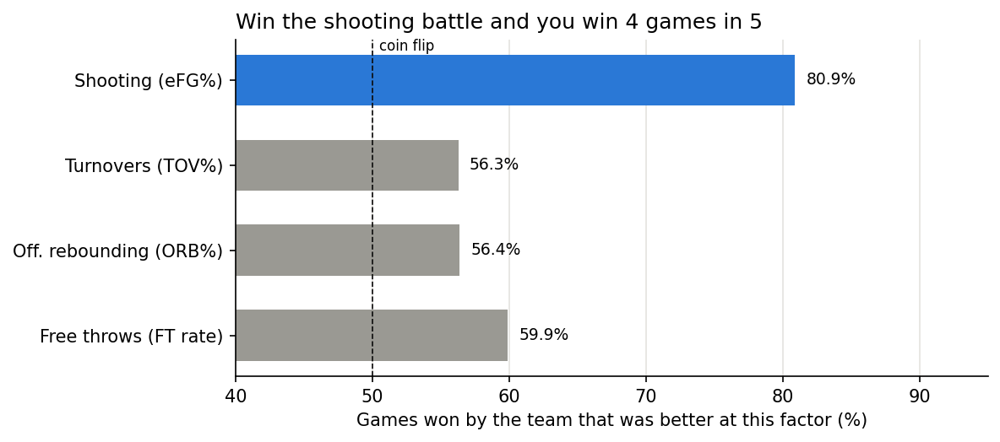
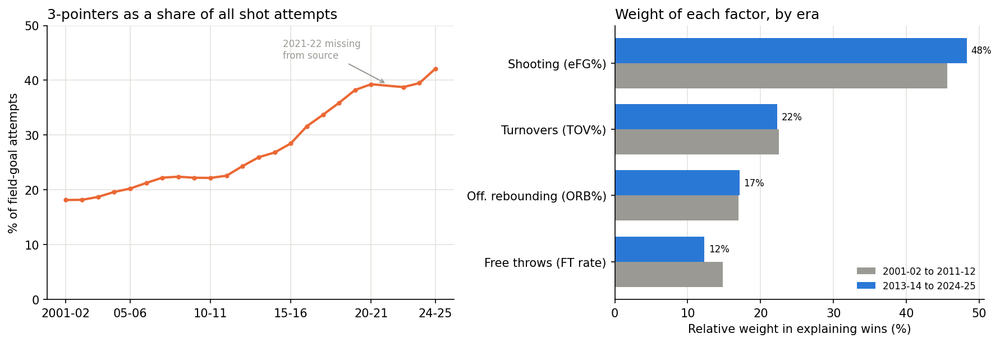

# What separates winning performances in the NBA?

**Question:** of the four things a team controls (shooting efficiency, turnovers, offensive rebounding and free throws), which matters most for winning, and has the 3-point revolution changed the answer?

**Tools:** Python (pandas, scikit-learn, matplotlib), Jupyter · **Notebook:** [`nba_four_factors.ipynb`](nba_four_factors.ipynb)

## Findings

Across **27,601 regular-season games, 2001-02 to 2024-25**:

| | Finding |
|---|---|
| **Shooting decides most games** | The team with the better effective field-goal % (eFG%) won **80.9%** of games. Being better on turnovers, offensive rebounds or free throws alone wins only 56–60%. |
| **Relative weights** | Shooting **47%**, turnovers 22%, offensive rebounding 17%, free throws 14%, close to Dean Oliver's long-standing 40/25/20/15 estimate. |
| **Four numbers explain the result** | A logistic regression trained on games up to 2019-20 classified **95.4%** of 4,846 later, unseen games correctly (AUC 0.993). |
| **The 3-point era barely moved the weights** | 3-pointers rose from 18% to 42% of all shots, yet shooting's weight rose only from 46% to 48% and free throws' fell from 15% to 12%. |




## Recommendations for a coaching staff

1. **Spend the most time on shot quality**, both taking good shots and forcing bad ones. The model weighs your eFG% and your opponent's equally, so defence counts as much as offence.
2. **Turnovers are the second lever**, worth about half as much as shooting.
3. Offensive rebounding and drawing fouls help, but not at the cost of transition defence or shot selection.

## Method notes

- **The Four Factors** for each team in each game: eFG% = (FGM + 0.5 × 3PM) / FGA; TOV% = TOV / (FGA + 0.44 × FTA + TOV); ORB% = ORB / (ORB + opponent DRB); FT rate = FTM / FGA. The model uses each factor's gap between the two teams.
- **One row per game.** The source has one row per team, so each game appears twice; the analysis keeps the home team's view to avoid double counting.
- **Train on the past, test on the future.** The model is fitted on 2001-02 to 2019-20 and tested on later seasons it never saw.
- **This explains, it doesn't predict.** The factors are measured in the same game they explain, so the 95% is not a pre-game forecast.

## Data quality

A completeness check on games per season found **two seasons the source is missing games for**: 2000-01 has 592 of 1,189 games and 2021-22 has a single game. Both are excluded. Shortened seasons that really happened (2011-12 lockout, 2019-20 and 2020-21 COVID seasons) are kept.

## Data

[Historical NBA Data and Player Box Scores](https://www.kaggle.com/datasets/eoinamoore/historical-nba-data-and-player-box-scores) by Eoin A Moore (Kaggle), `TeamStatistics.csv`, **pinned to version 552** because the dataset is updated daily. The CSV (36 MB) isn't stored in this repo; `download_data.py` fetches it without a Kaggle account.

## Run it

```bash
pip install kagglehub pandas numpy scikit-learn matplotlib jupyter
python download_data.py
jupyter notebook nba_four_factors.ipynb
```
