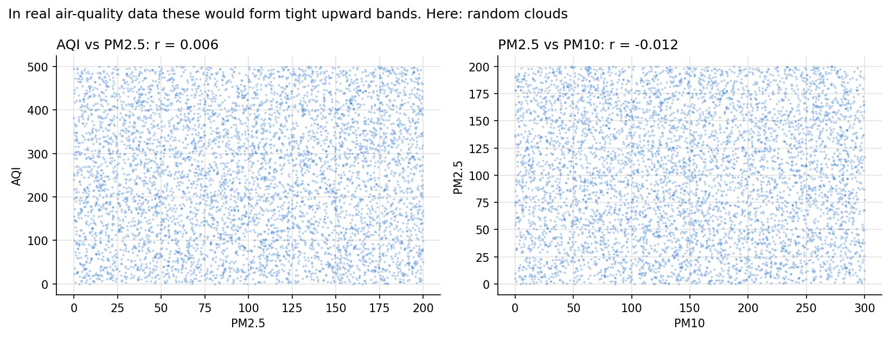

# Is this data real? A sanity check of two popular Kaggle datasets

**Question:** can the widely used *Cyber Security Attacks* and *Air Quality and Health Impact* datasets support the "attack patterns" and "pollution–health links" that projects built on them report?

**Answer: no. Both datasets are synthetic**: generated at random, with no real-world relationships in them.

**Tools:** Python (pandas, SciPy, statsmodels, matplotlib), Jupyter · **Notebook:** [`synthetic_data_sanity_check.ipynb`](synthetic_data_sanity_check.ipynb)

## Evidence

**Cyber Security Attacks** (40,000 rows)

- **Places don't exist.** Each of the 316 Indian cities appears in 24 to 28 of the 28 states; Ghaziabad, a city in Uttar Pradesh, appears in Goa, Kerala and Assam.
- **No attacker or target ever repeats**: 40,000 unique source IPs and 40,000 unique destination IPs.
- **Payloads are lorem ipsum** placeholder text.
- **Every category is split evenly**: attack type, severity, protocol, action taken, traffic type and network segment are each about 33/33/33.
- **Nothing is related**: attack type vs severity has Cramér's V = 0.005, and attacks are flat across the hours of the day.

**Air Quality and Health Impact** (5,811 rows)

- **AQI is unrelated to the pollutants it is calculated from**: correlation with PM2.5 = 0.006. Real AQI is *defined* from pollutant levels.
- **PM2.5 and PM10 are unrelated** (r = −0.012), although PM2.5 is part of PM10.
- **Readings are flat across their ranges** (AQI, PM2.5, ozone, temperature, humidity, wind), not clustered like real measurements.
- **Respiratory cases are pure random counts**: mean 9.97, variance 9.79 (a Poisson signature), and pollution plus weather explain 0.13% of their variation.




## A reusable checklist

| Check | Real data usually | These datasets |
|---|---|---|
| Do linked fields agree (city ↔ state, AQI ↔ pollutants)? | Yes | No |
| Do identifiers repeat (IPs, customers, devices)? | Heavily | Never |
| Are categories lopsided? | Usually | Evenly split |
| Do related variables move together? | Yes | No |
| Are measurements clustered with long tails? | Yes | Flat |
| Is there a daily or seasonal rhythm? | Yes | Flat, or no dates |
| Is free text meaningful? | Yes | Lorem ipsum |

## Why this project exists

An earlier version of this repository analysed both datasets in Excel and R and reported findings such as "DDoS is the predominant attack vector" and "a strong positive relationship between AQI and respiratory cases". Those findings were random variation in synthetic data. This notebook replaces that work and shows how to catch the problem in five minutes, before any analysis.

The datasets are still fine for practising tools (pivot tables, charts, SQL syntax), as long as the output isn't presented as insight.

## Data

- [Cyber Security Attacks](https://www.kaggle.com/datasets/teamincribo/cyber-security-attacks) (Kaggle), saved as `data/cybersecurity_attacks.csv.gz`
- [Air Quality and Health Impact](https://www.kaggle.com/datasets/rabieelkharoua/air-quality-and-health-impact-dataset) (Kaggle), saved as `data/air_quality_health_impact_data.csv.gz`

## Run it

```bash
pip install pandas numpy scipy statsmodels matplotlib jupyter
jupyter notebook synthetic_data_sanity_check.ipynb
```
