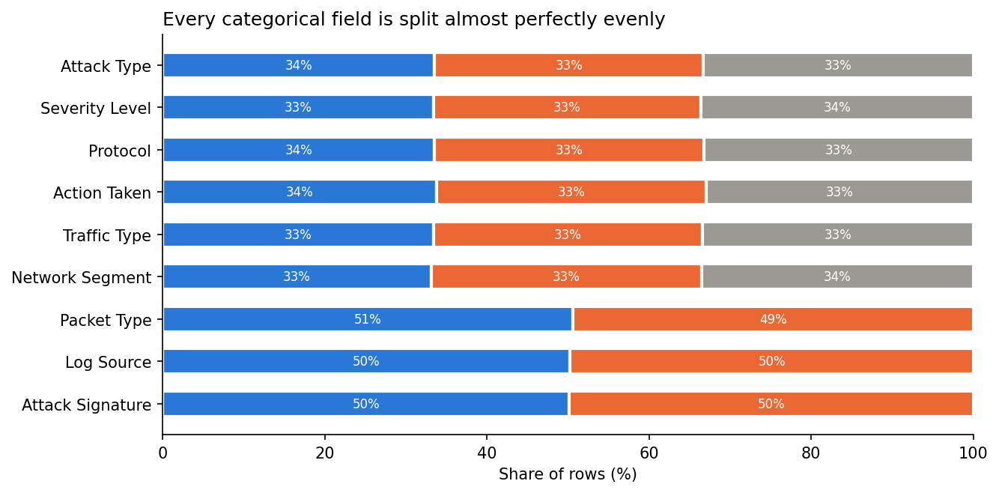

# Is this data real? A sanity check of two popular Kaggle datasets

**Question:** can the widely used *Cyber Security Attacks* and *Air Quality and Health Impact* datasets support the "attack patterns" and "pollution–health links" that projects built on them report?

**Answer: no. Both datasets are synthetic**: generated at random, with no real-world relationships in them.

**Deliverable:** the manual investigation, plus **`datasanity`**, a tested library and command-line tool that runs the same checks on any CSV or Excel file and was validated against both synthetic datasets and three real ones.

**Tools:** Python (pandas, SciPy, statsmodels), pytest · **Notebook:** [`synthetic_data_sanity_check.ipynb`](synthetic_data_sanity_check.ipynb) · **Package:** [`src/datasanity`](src/datasanity) · **Methodology:** [`docs/methodology.md`](docs/methodology.md)

## Evidence

**Cyber Security Attacks** (40,000 rows)

- **Places don't exist.** Each of the 316 Indian cities appears in 24 to 28 of the 28 states; Ghaziabad, a city in Uttar Pradesh, appears in Goa, Kerala and Assam.
- **No attacker or target ever repeats**: 40,000 unique source IPs and 40,000 unique destination IPs.
- **Payloads are lorem ipsum** placeholder text.
- **Every category is split evenly**: attack type, severity, protocol, action taken, traffic type and network segment are each about 33/33/33.
- **Nothing is related**: attack type vs severity has Cramér's V = 0.005, and attacks are flat across the hours of the day.

**Air Quality and Health Impact** (5,811 rows)

- **AQI is unrelated to the pollutants it is calculated from**: correlation with PM2.5 = 0.006. Real AQI is *defined* from pollutant levels.
- **PM2.5 and PM10 are unrelated** (r = −0.012), although PM2.5 is part of PM10.
- **Readings are flat across their ranges** (AQI, PM2.5, ozone, temperature, humidity, wind), not clustered like real measurements.
- **Respiratory cases are pure random counts**: mean 9.97, variance 9.79 (a Poisson signature), and pollution plus weather explain 0.13% of their variation.




## A reusable checklist

| Check | Real data usually | These datasets |
|---|---|---|
| Do linked fields agree (city ↔ state, AQI ↔ pollutants)? | Yes | No |
| Do identifiers repeat (IPs, customers, devices)? | Heavily | Never |
| Are categories lopsided? | Usually | Evenly split |
| Do related variables move together? | Yes | No |
| Are measurements clustered with long tails? | Yes | Flat |
| Is there a daily or seasonal rhythm? | Yes | Flat, or no dates |
| Is free text meaningful? | Yes | Lorem ipsum |

## The `datasanity` tool

```bash
datasanity data.csv                       # Markdown report in the terminal
datasanity a.csv b.xlsx --out reports/    # one report per file
datasanity data.csv --format json         # machine-readable
datasanity data.csv --fail-on-synthetic   # exit code 1 if LIKELY SYNTHETIC: a gate for data pipelines
```

```python
from datasanity import check_dataframe
report = check_dataframe(df, name="vendor_file")
report.verdict          # 'LIKELY SYNTHETIC' | 'INVESTIGATE' | 'NO SYNTHETIC SIGNALS'
report.to_frame()       # one row per check
```

**Eight kinds of evidence**: evenly split categories, flat numeric distributions, no relationships between numeric columns, place names that don't nest, lorem-ipsum text, IP addresses that never repeat, leading digits far from Benford's law, and timestamps with no daily rhythm. Each check reports *not applicable* when the data has nothing for it to test.

**Verdict rule.** One triggered check is weak evidence (real data can be balanced by design), so **LIKELY SYNTHETIC needs two or more independent kinds**; one gives **INVESTIGATE**.

**Validation:** the false-positive control is what makes it trustworthy:

| Dataset | Type | Checks applicable | Triggered | Verdict |
|---|---|---|---|---|
| Cyber Security Attacks | synthetic | 8 | 8 | LIKELY SYNTHETIC |
| Air Quality and Health Impact | synthetic | 4 | 3 | LIKELY SYNTHETIC |
| Netflix titles | real | 3 | 0 | NO SYNTHETIC SIGNALS |
| Adani Ports daily prices | real | 5 | 0 | NO SYNTHETIC SIGNALS |
| NBA team box scores (147,116 rows) | real | 5 | 0 | NO SYNTHETIC SIGNALS |

**Limits.** It catches *naive* random generation. Data synthesised to preserve real distributions and correlations (for example by a generative model) is designed to pass checks like these.

## Project structure

```
04-synthetic-data-sanity-check/
├── synthetic_data_sanity_check.ipynb   # investigation (Parts 1-2) and tool validation (Part 3)
├── src/datasanity/
│   ├── checks.py                       # the eight checks; each returns a CheckResult
│   ├── report.py                       # verdict logic, Markdown and JSON reports
│   └── cli.py                          # `datasanity` command
├── tests/test_datasanity.py            # 20 tests: each check on constructed data + real-file validation
├── docs/methodology.md                 # thresholds, calibration values, design decisions
└── data/                               # the two synthetic datasets (gzipped CSV)
```

## Why this project exists

An earlier version of this repository analysed both datasets in Excel and R and reported findings such as "DDoS is the predominant attack vector" and "a strong positive relationship between AQI and respiratory cases". Those findings were random variation in synthetic data. This project replaces that work, and the tool makes the check repeatable in seconds, before any analysis.

## Data

- [Cyber Security Attacks](https://www.kaggle.com/datasets/teamincribo/cyber-security-attacks) (Kaggle), saved as `data/cybersecurity_attacks.csv.gz`
- [Air Quality and Health Impact](https://www.kaggle.com/datasets/rabieelkharoua/air-quality-and-health-impact-dataset) (Kaggle), saved as `data/air_quality_health_impact_data.csv.gz`

## Run it

From the repository root:

```bash
make setup                                              # installs the `datasanity` command
datasanity 04-synthetic-data-sanity-check/data/cybersecurity_attacks.csv.gz
.venv/bin/python -m pytest 04-synthetic-data-sanity-check/tests
.venv/bin/python tools/run_notebooks.py 04-synthetic --write
```
