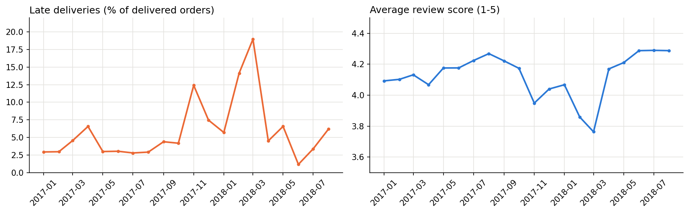
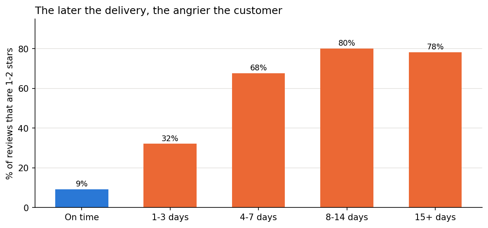
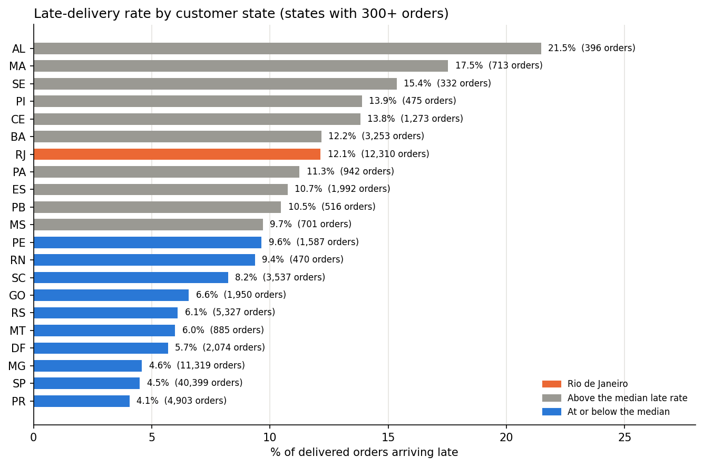

# Olist marketplace: growth, retention and the cost of late deliveries

**Questions** for an e-commerce marketplace's leadership: where does growth come from, do customers come back, how much does delivery performance affect satisfaction, and should the next investment go into retention or the first-order experience?

**[Live dashboard →](https://olist-marketplace-dashboard.vercel.app/)**

**Tools:** SQL (DuckDB) warehouse with staging models, marts and data tests · Python (pandas, statsmodels, scikit-learn) · interactive web dashboard · **Notebook:** [`olist_analysis.ipynb`](olist_analysis.ipynb) · **Dashboard:** [`dashboard/`](dashboard) · **Methodology:** [`docs/methodology.md`](docs/methodology.md)

## Findings

About 99,000 real orders, January 2017 – August 2018 (complete months):

| | Finding |
|---|---|
| **Growth is acquisition-driven** | GMV grew **140%** year on year (Jan–Aug 2018 vs 2017, R$ 3.6M → R$ 8.6M), almost all from new customers: returning customers place **3.3%** of orders and only **3.0%** of customers ever buy twice. |
| **Late delivery costs about two stars** | 6.8% of delivered orders arrive after the promised date. Late orders score **1.97 stars lower** after controlling for category, state, month, order value, freight, items and sellers (95% CI 1.93–2.01). |
| **And it compounds** | 1–3 days late already lifts 1–2-star reviews from 9% to 32%; 4–7 days late, 68%. Monthly late rate and average review correlate at −0.87. |
| **Lateness is concentrated** | Worst in the far north-east (Alagoas 21.5%) and in **Rio de Janeiro: 12.1% late, 2.7× São Paulo**, despite a median seller distance of only 394 km. Peaks follow Black Friday 2017 and Feb–Mar 2018 (up to 19% late). |
| **Retention has a low ceiling** | Repeat buying is rare, only weakly predictable (AUC 0.59; the top-scored 10% repeat at 1.8× the base rate), and not measurably reduced by a late first delivery (odds ratio 0.90, 95% CI 0.74–1.10). |





## Recommendations

1. **Invest in the first-order experience, not retention campaigns.** Growth comes from new customers, and reviews are what new customers see.
2. **Fix Rio de Janeiro first:** the biggest gap between expected and actual delivery performance, in the second-largest market. Matching São Paulo's late rate would have avoided about 940 late orders over the period.
3. **Plan carrier capacity for peaks.** The late rate at least doubled after Black Friday and again in February–March.
4. **Track late rate by state weekly,** and set regional delivery promises for the north-east.
5. **Use the repeat-propensity model only for cheap targeting** (e.g. who gets a follow-up offer), not as a basis for retention strategy.

## Dashboard

**Live at https://olist-marketplace-dashboard.vercel.app/** (redeploys automatically when the dashboard folder changes). [`dashboard/index.html`](dashboard/index.html): KPI tiles, first vs repeat orders by month, late rate and reviews with a **state filter**, lateness dose-response, late rate by state, RFM segments and a cohort-retention heatmap. Light and dark themes. It's a static page, so it can also be opened locally:

```bash
cd 05-olist-ecommerce-analytics/dashboard && python -m http.server 8000   # then open http://localhost:8000
```

## Concepts and techniques

**Data engineering and modelling**
- Layered ELT warehouse in DuckDB (raw, staging, marts), following the dbt pattern
- Dimensional modelling: an order fact table and a customer dimension
- SQL data tests: uniqueness, not-null, accepted ranges, referential integrity, business rules and a tolerance test
- Cleaning in SQL: deduplicating reviews with `row_number`, filtering bad geocodes, translating categories, defining an analysis window

**SQL techniques**
- CTE pipelines; window functions (`row_number`, `ntile`, `count over`)
- `arg_min` / `arg_max` for first-order attributes; filtered aggregates
- Date arithmetic for cohorts and delivery times
- Great-circle (haversine) distance in SQL

**Business analytics**
- KPI design: GMV, orders, average order value, late rate, repeat rate, review score
- Year-on-year growth on like-for-like months
- Cohort retention analysis; RFM customer segmentation
- Geographic performance analysis; impact sizing (late orders avoided)
- Customer lifetime value reasoning: why a BG/NBD model isn't appropriate with 97% one-time buyers

**Statistics and causal thinking**
- OLS with fixed effects (category, state, month) and heteroskedasticity-robust standard errors
- Dose-response analysis
- Logistic regression with a convergence check
- Equal follow-up windows to avoid time-at-risk bias
- Separating association from causation

**Machine learning**
- Repeat-purchase propensity model with a time-based split
- Evaluation for rare outcomes: AUC, average precision, top-decile lift

**Communication**
- Interactive dashboard (KPI tiles, filters, cohort heatmap) and an executive summary ([SUMMARY.md](SUMMARY.md))

**Engineering**
- Tested Python package (`src/olist_analytics`), warehouse tests on fixture data with planted edge cases, pinned data download, CI

## How it's built

```
05-olist-ecommerce-analytics/
├── sql/
│   ├── 01_staging/   # 8 models: typed, cleaned, one per source (reviews deduplicated, geocodes filtered...)
│   ├── 02_marts/     # fct_orders, dim_customers, monthly KPIs, cohort retention, RFM, delivery by state
│   └── 03_tests/     # 11 data tests: uniqueness, ranges, referential integrity, business rules
├── src/olist_analytics/
│   ├── warehouse.py  # loads raw CSVs, runs models in order, runs data tests (fails loudly)
│   └── analysis.py   # growth, late-review effect, dose-response, repeat-purchase analyses, propensity model
├── dashboard/        # build_dashboard.py -> data.json; index.html (Chart.js)
├── tests/            # 13 tests: full warehouse on hand-built fixture data with planted edge cases, plus real data
├── olist_analysis.ipynb
└── docs/methodology.md
```

**SQL highlights:** window functions (`row_number` for deduplication and order sequence, `ntile` for RFM scores, `arg_min`/`arg_max` for first-order attributes), CTE pipelines, cohort retention via `date_diff`, great-circle distance in SQL, and dbt-style data tests that return the offending rows.

## Data quality

The warehouse fixes and documents rather than silently dropping:
- **Reviews:** 99,224 review rows for 98,673 orders, and review IDs aren't unique; each order keeps its most recent review (tested).
- **Geocodes:** points outside Brazil are discarded; each zip prefix uses its median position; 477 delivered orders have no usable location.
- **Delivered without a date:** 8 orders, excluded from timing analysis.
- **Payments vs items:** 0.25% of orders disagree by more than R$ 1 (vouchers, rounding); a data test fails above 1%.
- **Categories:** 610 products without a category become "unknown"; 2 untranslated categories keep their Portuguese name.
- **Window:** 2016 is sparse and September–October 2018 are fragments, so marts use January 2017 – August 2018.

## Run it

From the repository root:

```bash
make setup
.venv/bin/python 05-olist-ecommerce-analytics/download_data.py   # ~130 MB, pinned Kaggle version 2
.venv/bin/python -m pytest 05-olist-ecommerce-analytics/tests
.venv/bin/python tools/run_notebooks.py 05-olist --write
make dashboard
```

Explore the warehouse directly:

```python
from olist_analytics import warehouse
con = warehouse.build()
warehouse.query(con, "select segment, count(*) from mart_rfm group by 1")
```

## Data

[Brazilian E-Commerce Public Dataset by Olist](https://www.kaggle.com/datasets/olistbr/brazilian-ecommerce) (Kaggle), pinned to version 2: nine linked tables of real, anonymised orders. Not stored in the repo; `download_data.py` fetches it without a Kaggle account.
